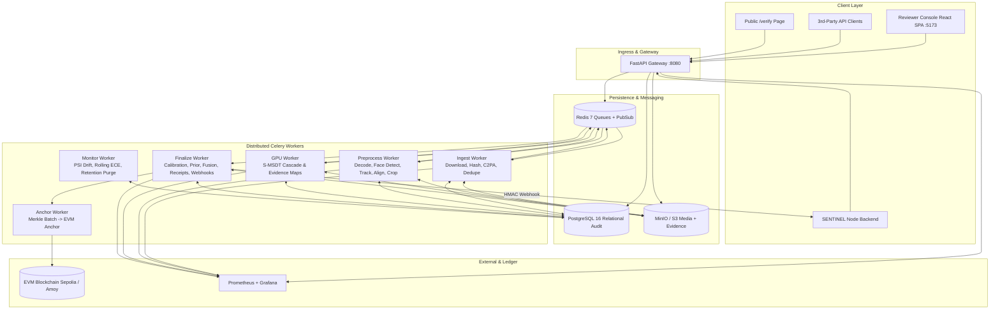
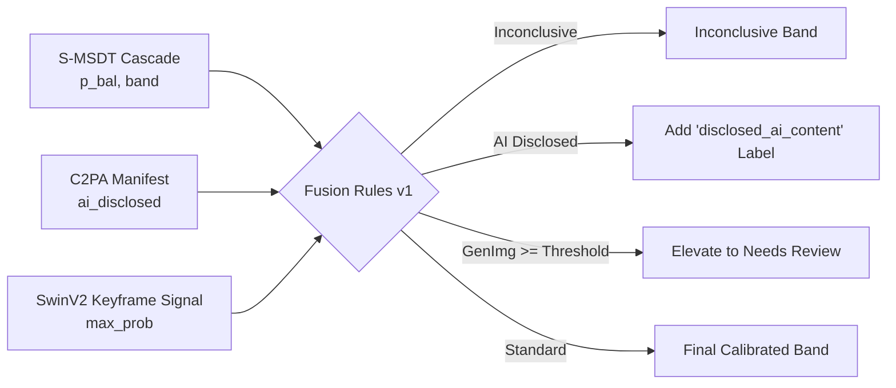

# SENTINEL-V System Architecture

This document provides an in-depth breakdown of the SENTINEL-V architecture, data pipelines, subsystems, and security model.

---

## 1. High-Level System Architecture



---

## 2. Ingestion & Preprocessing Subsystem

1. **Intake & Sniffing:**
   - Raw video stream arrives via multipart upload or remote URL.
   - Streaming SHA-256 calculation. Magic bytes verification. Container metadata probed via `ffprobe`.
   - C2PA provenance manifest parsed via `c2pa-python`.
2. **Deduplication:**
   - Query DB for existing record with identical `(media.sha256, model_bundle_id, policy_version)`.
   - On match within 30 days, reuse previous analysis with `cache_hit=True`.
3. **Face Tracking & Cropping:**
   - InsightFace `buffalo_l` detectors run on sampled frames.
   - Greedy IoU tracking across consecutive frames.
   - Savitzky-Golay filtering smooths 106-point landmarks.
   - Similarity transform creates 256x256 crops (`loose_template`, margin 1.3), followed by 224 center-crop.
   - Affine matrices $M$ and $M_{224}$ preserved for coordinate back-projection.
   - $K=8$ clips of $T=8$ contiguous frames per track written to S3 as `.npz`.

---

## 3. Two-Stage S-MSDT Cost Cascade

```
                  ┌────────────────────────────────────┐
                  │ Preprocessed Clip Tensors (K=8, T) │
                  └─────────────────┬──────────────────┘
                                    │
                                    ▼
                  ┌────────────────────────────────────┐
                  │ Stage 1: S-MSDT-S (T=1)            │
                  │ Logit u_1 -> Platt Calibration p_1 │
                  └─────────────────┬──────────────────┘
                                    │
                         p_1 < exit_below_p_bal?
                         /                     \
                   Yes  /                       \  No
                       ▼                         ▼
        ┌─────────────────────────┐   ┌─────────────────────────┐
        │ Exit Early: Stage 1     │   │ Escalate: Stage 2       │
        │ Decision = p_1          │   │ S-MSDT-ST (T=8)         │
        │ (~70% compute saved)    │   │ Logit u_2 -> Calib p_2  │
        └──────────────┬──────────┘   └────────────┬────────────┘
                       │                           │
                       └─────────────┬─────────────┘
                                     ▼
                      ┌──────────────────────────────┐
                      │ Track Aggregation:           │
                      │ Video Logit = max_j(u_j)     │
                      │ Decisive Track = argmax_j    │
                      └──────────────────────────────┘
```

---

## 4. Multi-Signal Fusion



---

## 5. Security & Isolation Architecture

1. **SSRF Guard:**
   - DNS pre-resolved before HTTP connections.
   - Strict blocklist: 10.0.0.0/8, 172.16.0.0/12, 192.168.0.0/16, 127.0.0.0/8, 169.254.169.254 (cloud metadata), ::1, fc00::/7.
   - Maximum 3 redirect hops, re-checking DNS on each redirect.
2. **Container Sandboxing:**
   - Worker containers run as non-root user with read-only root filesystems and a tmpfs scratch directory.
   - CPU and memory limits enforced via cgroups.
   - Isolated Docker bridge network (`internal`) without public outbound access for processing workers.
3. **Data Retention & Privacy:**
   - Raw video media deleted automatically after 30 days (`SV_RETENTION_MEDIA_DAYS`).
   - Evidence heat-maps deleted automatically after 180 days (`SV_RETENTION_EVIDENCE_DAYS`).
   - Detection receipts kept permanently (receipts contain cryptographic digests, never raw media).
   - Right-to-erasure endpoint: `DELETE /v1/media/{id}` purges media and evidence while retaining receipts.
