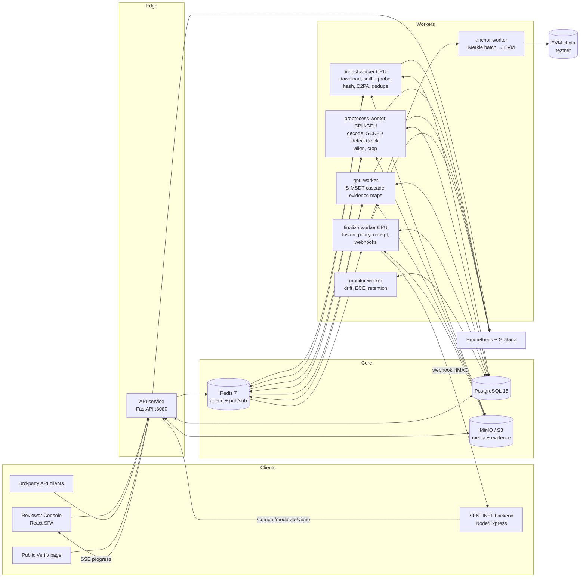

# SENTINEL-V — Calibrated, Auditable Video Deepfake Screening

**Build Specification v1.0 for a coding agent. Read this whole file before writing any code.**

| Field | Value |
|---|---|
| Product | SENTINEL-V: a video-forensics service plus a reviewer console, built on the S-MSDT detector family |
| Upstream model repo | `github.com/sharadpolackalsunil/DeepFake` (package `smsdt`, commit `11587f5` or later) |
| Integration target | `github.com/Omnivision-Projects/SENTINEL` (Web3 content-verification hub; image-only moderation today) |
| Research outputs | Paper A: S-MSDT model paper (exists, IEEE TIFS draft). Paper B: the system paper this build enables (§15) |
| Reference GPU | NVIDIA RTX 5090 (32 GB), CUDA 12.8, PyTorch ≥ 2.5 |
| Spec status | Final for M0–M11. Items marked **[BLOCKER]** need a human before the agent can finish them |

**Contents:** 0 Agent instructions · 1 Goal & scope · 2 Model facts · 3 Architecture · 4 Repo layout · 5 Configuration · 6 ML engine · 7 Cascade & base rates · 8 Evidence · 9 Fusion · 10 Receipts & anchoring · 11 SENTINEL integration · 12 Security · 13 Monitoring & drift · 14 UI plan · 15 Evaluation harness & Paper B · 16 Milestones · 17 Blockers · 18 Roadmap · 19 API reference · 20 Data model · 21 Testing & CI · 22 Deployment · 23 Definition of done · Appendices A–C

---

## 0. How to use this document (instructions for the coding agent)

1. Work **milestone by milestone** (§16). Do not start a milestone until the previous one meets every acceptance criterion.
2. Every milestone ends with: tests green, `docker compose up` healthy, `docs/CHANGELOG.md` updated, and a short `docs/milestones/Mx.md` report covering what was built, what was deferred, and the measured numbers.
3. **Never invent model results.** Any number shown in the UI, in docs, or in a paper table must come from a file the code produced (`eval/results/*.csv`) or from a `calibration.json` fitted by `tools/fit_calibration.py`. Placeholders are `null` in data and `—` in the UI.
4. **Parity before features.** The serving pipeline must reproduce the research evaluation (`smsdt/eval_cross.py`) within the tolerances in §6.9 before any UI work depends on scores.
5. **Do not modify upstream repositories in place.** Vendor `smsdt` as a git submodule or a pinned pip dependency. SENTINEL's `GEMINI.md` declares its Web3, contract, image-deepfake and video files **locked**. Integrate only through new, additive files (§11).
6. Ask a human (open `docs/QUESTIONS.md` and stop that sub-task) only for the **[BLOCKER]** items in §17. Otherwise make the conventional choice, record it in `docs/DECISIONS.md` (ADR format), and continue.
7. Language and tooling: Python 3.11 (backend and ML), TypeScript 5 (web), Solidity 0.8.24 (optional anchoring). Formatters: `ruff format`, `ruff check`, `mypy --strict` on `services/*` (not on vendored `smsdt`), `eslint`, `prettier`. Write a test before each feature.

---

## 1. Problem and product goal

Platforms, newsrooms, fact-checkers and evidence-handling units receive videos of people and must decide whether a face in a video was manipulated. Existing tools typically do one or more of the following:
- return one uncalibrated "fake %" number with a hard-coded threshold (SENTINEL today uses a single image model with `FAKE_THRESHOLD = 0.65`);
- ignore base rates (most uploaded videos are genuine, so even a good detector produces many false alarms);
- give the human reviewer no evidence;
- keep no auditable record of which model, which calibration and which threshold produced a verdict.

**SENTINEL-V does four things:**
1. **Screens** uploaded or linked videos with the S-MSDT detector family (face-manipulation detection: identity swap and expression re-enactment). A cost cascade sends only uncertain or suspicious videos to the expensive model.
2. **Calibrates** every score. It returns a probability calibrated on validation data, a decision band from a versioned policy, and a **prevalence-aware estimate of precision** for the deployment's configured base rate.
3. **Explains** each decision for a human reviewer: per-clip score timeline, patch-evidence heat-maps warped back onto the original frames, the signals that contributed, and the model card's known limitations.
4. **Proves** what happened. Every verdict yields a signed, canonical **Detection Receipt** (content hash, model weights hash, calibration hash, policy version, scores, evidence hash). Receipts can be batch-anchored on an EVM chain and verified by anyone.

### 1.1 Users and roles

| Role | Needs |
|---|---|
| **Submitter** (API client, SENTINEL backend, journalist) | Submit a video and get a calibrated verdict plus a receipt quickly; get a webhook when done |
| **Reviewer** (trust-and-safety analyst, fact-checker) | A queue of uncertain cases and fast evidence review. Records decisions with reasons. Must not be misled by over-confident UI |
| **Admin / ML owner** | Register model versions, inspect calibration, promote or roll back, set policies (thresholds, prevalence), watch drift |
| **Auditor / public verifier** | Given a video and a receipt, verify integrity and provenance without trusting the operator |
| **Researcher** (us) | Run the Paper B evaluation harness reproducibly from the same code that serves production |

### 1.2 Scope

**In scope (v1):** video files and URLs (MP4/MOV/WebM/MKV/AVI), face-manipulation detection, multi-face videos (up to 4 tracks), C2PA provenance reading, an optional still-image AI-generation signal on keyframes (re-using SENTINEL's SwinV2 ONNX model if available), reviewer console, receipts, optional on-chain anchoring, SENTINEL integration adapter, monitoring and drift, and the evaluation harness.

**Out of scope (v1), stated in the UI model card:**
- detecting fully generated video (text-to-video), because S-MSDT was trained on FF++ face manipulations (evaluated as a known gap in §15);
- audio deepfakes;
- live RTSP streams (designed for in §18 roadmap, not built);
- mobile apps;
- any claim of legal admissibility.

### 1.3 Non-negotiable product principles

1. **No bare "FAKE/REAL".** The UI and API always present: calibrated probability, decision band, policy version and model version, plus "screening aid — human review required for consequential action".
2. **Inconclusive is a first-class outcome:** no face, face too small, too few trackable frames, or decode failure.
3. **Thresholds are fitted on validation data and frozen.** Never tune on production or test data. Recalibration is an explicit, logged admin action with its own data provenance.
4. **Reproducibility.** Every result row stores `model_version_id`, `weights_sha256`, `calibration_sha256`, `policy_version`, `pipeline_version` (git SHA), `preprocess_params_hash`.
5. **Privacy by default.** Raw media is retention-limited (default 30 days), evidence artifacts 180 days, receipts forever (receipts hold hashes, never media).
6. **Dual-use care.** Anonymous or public API callers get quantized probabilities (2 decimals) and no patch logits, and are rate-limited, so the service cannot be used as an oracle to tune forgeries (§12.6).

---

## 2. Facts about the models this build depends on

These come from the S-MSDT repo and the Paper A results. **Do not change them without updating `models/<id>/model_card.md`.**

### 2.1 Variants

| Variant id | Paper name | Backbone | Frames/clip T | Inputs | Normalization | Checkpoint source | Calibration status |
|---|---|---|---|---|---|---|---|
| `smsdt-cnn-p1` | S-MSDT-CNN (Phase 1) | EfficientNet-B4 + Haar DWT + DensePSIT 14×14 | 8 | (B,T,3,224,224) + conf (B,T) | **[0,1], no mean/std** | `SMSDT` in `smsdt/models/smsdt.py` | must be fitted (§6.7) |
| `smsdt-s-a` | S-MSDT-S (Stage A fixed) | CLIP ViT-L/14, LayerNorm-tuned | 1 | (B,1,3,224,224) | CLIP mean/std | `SMSDTv2` + `CLIPFrameEncoder` | must be fitted |
| `smsdt-st-b` | S-MSDT-ST (Stage B fixed) | + TemporalDiff, 2 NMSSS blocks | 8 | (B,8,3,224,224) | CLIP mean/std | `SMSDTv2` | **known:** Platt a=0.6470, b=−0.5865, τ*=0.7507 (Youden, validation) |
| `smsdt-full-c` | S-MSDT (Stage C / v3) | + ResidualStream (SRM+Haar, zero-init tanh gate), EvidenceReadoutV3 (LSE, perioral prior) | 8 | (B,8,3,224,224) + landmarks for prior | CLIP mean/std | **[BLOCKER B1]** v3 modules are not in commit `11587f5` | must be fitted |

The model forward pass returns `(logit: (B,), patch_logits: (B,T,P))`, with P=256 (16×16) for CLIP variants and P=196 (14×14) for the CNN.

### 2.2 Measured operating characteristics (Paper A, test split; for planning only, not for display)

| Pooled FF++ + DFD test | S | ST | Full |
|---|---|---|---|
| FF++ macro AUC | 0.936 | 0.938 | 0.935 |
| TPR @ 1% FPR | 50.7% | 47.1% | 39.4% |
| TPR @ 5% FPR | 63.9% | 58.9% | 53.0% |
| ECE (raw) | 0.227 | 0.184 | 0.178 |
| Celeb-DF v2 AUC (zero-shot) | TBD | 0.875 | 0.881 |
| Celeb-DF TPR @ 1% FPR | TBD | 21.1% | 24.1% |

Design consequences that this build **must** implement:
- **Model selection depends on the operating regime** (§7). S and ST are better at strict false-alarm budgets in-domain. Full transfers and calibrates better. The cascade uses S as the cheap screen and Full or ST as the decider, selected by policy.
- **Calibration does not transfer across datasets.** With ST's frozen τ*, Celeb-DF specificity is 96.1% but recall falls to 47.1%, and ECE rises from 0.176 to 0.238. The system therefore needs drift monitoring and a governed recalibration path (§13).
- **Base rates dominate precision** (§7.4). At 1% prevalence, Full at a 1%-FPR threshold flags about 138 videos per 10,000, of which only about 28.5% are fake.

### 2.3 Preprocessing facts (must match training/eval exactly)

From `smsdt/preprocess/build_store.py`, `align_crop.py`, `data/video_dataset.py` and `eval_cross.py`:
- **Detector:** InsightFace `FaceAnalysis(name="buffalo_l", allowed_modules=["detection","landmark_2d_106"])`, `det_size=(320,320)`.
- **Tracking:** IoU-based single-track extraction (`extract_video_track`, `max_track_frames=250`). Landmarks are smoothed with a Savitzky–Golay filter (`scipy.signal.savgol_filter`).
- **Crop:** similarity transform from 5 key points to `loose_template(out=256, margin=1.3)` (ArcFace template), `cv2.warpAffine(..., INTER_LINEAR, BORDER_REFLECT101)`, RGB output 256×256.
- **Eval crop:** deterministic **center crop 224** from the 256 store frame.
- **Eval clip sampling:** `VideoDataset(split=..., K=8, T=8, stride=1)`. That is K=8 clips of T=8 contiguous frames, with starts from `contiguous_starts(fidx, T, stride)`.
- **Video score:** `s(V) = mean_k sigmoid(logit_k)`. Calibration uses the **mean logit** `u(V) = mean_k logit_k`: `p_cal = sigmoid(a·u + b)`.
- **Normalization:** CLIP mean (0.48145466, 0.4578275, 0.40821073), std (0.26862954, 0.26130258, 0.27577711) for v2 and v3. **None** ([0,1] tensors) for v1 (CNN).
- **Perioral prior (Full only):** built from 106-point landmarks 52–71 warped into crop space (`warp_points`). **[BLOCKER B1]** supplies the exact function.

> **Parity rule.** Do not re-implement these steps "similarly". Import and call the upstream functions (`loose_template`, `crop_frame`, `warp_points`, `contiguous_starts`, `extract_video_track`) from the vendored `smsdt` package. If an upstream function is file- or store-bound, wrap it with a thin in-memory adapter and prove equivalence with a parity test (§6.9).

---

## 3. System architecture

### 3.1 Component diagram



### 3.2 Technology choices (fixed; record any deviation as an ADR)

| Concern | Choice | Reason |
|---|---|---|
| API | FastAPI + Pydantic v2 + Uvicorn | Same language as the ML code; OpenAPI generation for client codegen |
| Jobs | **Celery 5 + Redis** with named queues `ingest`, `preprocess`, `gpu`, `finalize`, `anchor`, `monitor`. GPU worker runs `--concurrency=1 --prefetch-multiplier=1` | Mature retries and routing; per-queue scaling |
| DB | PostgreSQL 16, SQLAlchemy 2 (async), Alembic | Relational audit data, JSONB for results |
| Object store | MinIO (dev and on-prem) or S3 (cloud) via `boto3`; presigned GETs | Media and evidence are large |
| Video decode | **PyAV** (FFmpeg bindings) for decoding; `ffprobe` for metadata. Honour rotation metadata; convert variable frame rate to an index timeline | Frame-accurate, no shell-out per frame |
| Face | `insightface==0.7.x` `buffalo_l` on onnxruntime-gpu | Parity with training |
| ML | PyTorch ≥ 2.5, bf16 autocast, `torch.inference_mode()`; optional `torch.compile` behind a flag | Parity with eval |
| C2PA | `c2pa-python` (read-only) | Same lib as SENTINEL |
| Signing | Ed25519 via `cryptography`; canonical JSON via RFC 8785 (JCS) (`rfc8785` package) | Deterministic, verifiable receipts |
| Chain (optional) | Solidity 0.8.24 + Foundry; `web3.py` in anchor-worker; testnet only (Sepolia or Polygon Amoy) | A new contract. SENTINEL's `SentinelRegistry.sol` is locked |
| Web | React 18 + TypeScript + Vite + Tailwind + Radix UI primitives + TanStack Query + React Router + Recharts + `hls.js` (not needed for MP4) | Matches the SENTINEL frontend stack (React, Vite, Tailwind) for later merging |
| Auth | Local accounts (argon2id) + JWT access (15 min) / refresh (7 d) in httpOnly cookies for the console; API keys (hashed, prefixed `sv_live_`) for machines; optional OIDC | Simple to self-host |
| Observability | Prometheus client, OpenTelemetry traces (OTLP), structured JSON logs (`structlog`), Grafana dashboards as code | Required for the latency table in Paper B |
| Packaging | Docker multi-stage images; `docker compose` for dev; Helm chart is optional (M11) | Reproducible |

### 3.3 Request lifecycle (happy path)

1. `POST /v1/analyses` (file or URL) → API validates, creates `media` (pending) and `analysis` (`queued`), and enqueues `ingest`. Returns **202** `{analysis_id}`.
2. **ingest:**
   - download (SSRF-safe) or move the multipart temp file → stream to S3 while computing SHA-256;
   - magic-byte sniff, then `ffprobe` (duration, fps, resolution, codec, rotation);
   - enforce limits (§12.3);
   - read the C2PA manifest;
   - **dedupe:** if an analysis with the same `(sha256, model_bundle_id, policy_version)` succeeded within 30 days, link to it and finish (`status=completed`, `cache_hit=true`).
3. **preprocess:** decode → detect and track faces → select ≤4 tracks → smooth landmarks → align and crop to 256 → center-crop 224 → build K clips per track. Store tensors as `uint8` `.npy` in S3 (`preprocessed/{analysis_id}/{track}.npz`) together with the affine matrices `M` and the frame indices.
4. **gpu:** the cascade (§7) runs the stage-1 model and, when needed, stage 2. It produces clip logits, patch logits and the video score per track, then evidence heat-maps (§8).
5. **finalize:**
   - aggregate across tracks: video logit = max over track logits, and the record keeps which track decided;
   - calibrate, apply prior correction, apply the policy band;
   - run fusion with C2PA and the generative-image signal (§9);
   - persist results, build and sign the receipt (§10), enqueue `anchor` if enabled;
   - send webhooks; publish `analysis.completed` on Redis pub/sub → SSE.
6. If the band is `needs_review`, or the policy flags it for audit sampling, add the item to the review queue.

Each stage emits progress events `{stage, pct, message}`. The API relays them over SSE at `GET /v1/analyses/{id}/events`.

### 3.4 Failure semantics

| Failure | Behaviour |
|---|---|
| Download timeout / 4xx / 5xx | `failed` with `error.code=SOURCE_UNREACHABLE`; 2 retries with backoff only for 5xx and timeouts |
| Not a video / unsupported codec | `failed`, `UNSUPPORTED_MEDIA` |
| No face in ≥ 90% of sampled frames | `completed` with `decision=inconclusive`, `reason=NO_FACE`. Fusion may still report C2PA and generative signals |
| Face too small (inter-ocular distance < 24 px after decode) | `inconclusive`, `FACE_TOO_SMALL` |
| < 8 consecutive trackable frames in every track | `inconclusive`, `TOO_FEW_FRAMES` |
| GPU OOM | Retry once with batch size halved; then `failed`, `INFERENCE_OOM` |
| Model bundle missing / checksum mismatch | Worker refuses to start (health check fails); no silent fallback |
| Worker crash mid-job | Celery `acks_late=True` + idempotent stage outputs keyed by `analysis_id` |

---

## 4. Repository layout (monorepo)

```
sentinel-v/
├── AGENTS.md                      # short bootstrap for coding agents → points to docs/SPEC.md
├── docs/
│   ├── SPEC.md                    # this file
│   ├── DECISIONS.md  QUESTIONS.md  CHANGELOG.md
│   ├── milestones/M0.md ...
│   ├── api/openapi.yaml           # generated, committed, diff-checked in CI
│   └── model_cards/               # rendered copies of models/*/model_card.md
├── third_party/
│   └── smsdt/                     # git submodule → sharadpolackalsunil/DeepFake @ pinned SHA
├── packages/
│   ├── sv_core/                   # shared: settings, schemas (pydantic), enums, errors, hashing, jcs
│   ├── sv_engine/                 # ML engine: preprocess, adapters, cascade, calibration, evidence
│   │   ├── preprocess/{decode.py, faces.py, tracks.py, align.py, clips.py}
│   │   ├── adapters/{base.py, cnn_p1.py, clip_s.py, clip_st.py, full_c.py}
│   │   ├── calibration.py  priors.py  cascade.py  evidence.py  registry.py
│   │   └── tests/
│   ├── sv_fusion/                 # C2PA, generative-image signal (SwinV2 ONNX), fusion rules/stacker
│   └── sv_receipts/               # receipt schema, canonicalization, Ed25519, Merkle, verify
├── services/
│   ├── api/                       # FastAPI app: routers, auth, SSE, compat endpoint
│   ├── workers/                   # Celery app + tasks per queue
│   └── monitor/                   # drift, ECE, retention jobs
├── web/                           # React console + public verify page
├── contracts/                     # Foundry project: ReceiptAnchor.sol + tests
├── integrations/
│   └── sentinel/                  # Node client, SQL migration, additive patch, README
├── models/                        # git-ignored; model bundles (§6.2)
├── eval/                          # Paper B harness (§15): configs, scripts, results/*.csv, figs/
├── tools/                         # fit_calibration.py, dump_scores.py, parity_check.py, make_bundle.py
├── infra/
│   ├── docker/{api,worker-cpu,worker-gpu,web}.Dockerfile
│   ├── compose.yaml  compose.gpu.yaml
│   ├── grafana/dashboards/*.json  prometheus.yml
│   └── helm/ (M11, optional)
├── scripts/dev_seed.py            # seeds demo users, policies, a demo model bundle in mock mode
├── Makefile                       # make dev | test | lint | parity | eval-all | bundle
└── .github/workflows/{ci.yml, contracts.yml, web.yml}
```

---

## 5. Configuration

All settings come from `sv_core.settings.Settings` (pydantic-settings), read from environment variables prefixed `SV_`. `.env.example` lists every variable.

| Variable | Default | Notes |
|---|---|---|
| `SV_ENV` | `dev` | `dev`/`staging`/`prod` |
| `SV_DATABASE_URL` | `postgresql+asyncpg://sv:sv@postgres:5432/sv` | |
| `SV_REDIS_URL` | `redis://redis:6379/0` | |
| `SV_S3_ENDPOINT`, `SV_S3_BUCKET`, `SV_S3_ACCESS_KEY`, `SV_S3_SECRET_KEY` | MinIO dev values | |
| `SV_ENGINE_MODE` | `real` | `real` or `mock` |
| `SV_MODEL_BUNDLE` | `bundle-2026-11-default` | Active bundle id. The admin UI can override it in the DB |
| `SV_DEVICE` | `cuda:0` | |
| `SV_MAX_UPLOAD_MB` | `500` | |
| `SV_MAX_DURATION_S` | `600` | |
| `SV_MAX_TRACKS` | `4` | |
| `SV_K_CLIPS` | `8` | Paper protocol |
| `SV_RETENTION_MEDIA_DAYS` | `30` | |
| `SV_RETENTION_EVIDENCE_DAYS` | `180` | |
| `SV_RECEIPT_SIGNING_KEY_PATH` | `/run/secrets/receipt_ed25519.pem` | Never in env or git |
| `SV_ANCHOR_ENABLED` | `false` | |
| `SV_ANCHOR_RPC_URL`, `SV_ANCHOR_CONTRACT`, `SV_ANCHOR_KEY_PATH`, `SV_ANCHOR_CHAIN_ID` | — | Testnet only by default |
| `SV_ANCHOR_BATCH_SECONDS` | `600` | Merkle batch interval |
| `SV_PUBLIC_SCORE_DECIMALS` | `2` | Quantization for public/anonymous callers |
| `SV_WEBHOOK_SECRET` | — | Default HMAC secret for clients without their own |
| `SV_COMPAT_SENTINEL_ENABLED` | `true` | Enables `/compat/moderate/video` |
| `SV_GEN_IMAGE_ONNX` | `models/aux/swinv2_ai_image/model.onnx` | Optional |

---

## 6. ML engine (`packages/sv_engine`)

### 6.1 Adapter interface

```python
# packages/sv_engine/adapters/base.py
from dataclasses import dataclass
from typing import Literal, Protocol
import torch

Variant = Literal["cnn", "s", "st", "full"]

@dataclass(frozen=True)
class ClipBatch:
    frames_u8: torch.Tensor          # (N, T, 224, 224, 3) uint8, RGB, center-cropped
    landmarks106: torch.Tensor | None  # (N, T, 106, 2) float32 in 224-crop coords (Full only)
    conf: torch.Tensor               # (N, T) float32 detector confidence

@dataclass(frozen=True)
class ClipOutput:
    logits: torch.Tensor             # (N,) float32
    patch_logits: torch.Tensor | None  # (N, T, P) float32, P = grid*grid
    grid: int                        # 16 for CLIP variants, 14 for CNN

class DetectorAdapter(Protocol):
    model_id: str
    variant: Variant
    T: int
    grid: int
    def load(self, bundle_dir: str, device: torch.device) -> None: ...
    def normalize(self, frames_u8: torch.Tensor) -> torch.Tensor: ...  # → (N,T,3,224,224) float
    @torch.inference_mode()
    def predict(self, batch: ClipBatch) -> ClipOutput: ...
    def warmup(self) -> None: ...     # one dummy forward; called at worker start
```

---

## 7. Cascade and operating regime (`cascade.py`)

Algorithm:
```
for each track j:
    s1 = stage1.predict(clips_j)              # S-MSDT-S (cheap: T=1)
    p1 = calib_stage1(mean(s1.logits))
    if cascade.enabled and p1 < exit_below_p_bal:
        result_j = stage1 result; exited_early = True
    else:
        s2 = stage2.predict(clips_j)          # ST or Full (T=8)
        result_j = stage2 result; exited_early = False
video result = max over tracks of calibrated stage-specific p_bal
```

---

## 8. Evidence and explainability (`evidence.py`)

- Patch-evidence maps: (K, T, P) reshaped to (grid, grid) → bilinearly upsampled to 224² → padded to 256² → warped back to original video frame coordinates via affine inverse $M^{-1}$.
- Normalization: fixed scale [0, 1] on $\sigma(\text{patch\_logit})$.
- Artifacts: WebP frames per track + `manifest.json` + `overlay_{track}.mp4`.
- Grad-CAM on NMSSS / spatial attention as a research option.

---

## 9. Fusion with other signals (`packages/sv_fusion`)

- Face manipulation (primary): S-MSDT cascade.
- Provenance C2PA: `c2pa-python` on media container.
- Generative image (auxiliary): SwinV2 ONNX model on full keyframes.
- Decision rules & logistic stacker (Fusion v2).

---

## 10. Detection Receipts and anchoring (`packages/sv_receipts`, `contracts/`)

- Canonical JSON via RFC 8785 (JCS).
- Ed25519 digital signature.
- Merkle batching and optional EVM anchoring via `ReceiptAnchor.sol`.
- Browser client-side verification via WebCrypto and ethers.js without trusting API.

---

## 11. SENTINEL integration (`integrations/sentinel/`)

- Additive compatibility endpoint: `POST /compat/moderate/video`.
- Webhook signature validation.
- Additive files: `videoModerationService.js`, `svWebhookRoutes.js`, `schema_update_v6_video.sql`, `VideoAuthenticityBadge.jsx`.
- Strict lock preservation on all existing SENTINEL files.

---

## 12. Security, privacy and abuse resistance

- SSRF prevention (DNS pre-resolution, private IP filters, redirect bounds).
- Sandboxed video processing with resource limits and non-root execution.
- Retention enforcement (30-day media, 180-day evidence).
- Dual-use protections (quantization, rate limits, no patch logits for public).

---

## 13. Monitoring, drift and recalibration (`services/monitor`)

- Population Stability Index (PSI) tracking daily on scores and input features.
- Rolling ECE on inverse-probability-weighted review samples.
- Governed recalibration lifecycle.

---

## 14. UI plan — Reviewer Console and Public Verify (`web/`)

- Calibrated honesty over drama (no bare FAKE/REAL stamps).
- EvidencePlayer with canvas overlay synced to video time.
- ClipTimeline with score vs time per track.
- Review queue keyboard shortcuts: 1/2/3, R, Enter, S, H, P, Space.
- Public Verify client-side zero-trust verification page.

---

## 15. Evaluation harness and Paper B (`eval/`)

- Manifests for FF++, DFD, Celeb-DF v2.
- Experiments E1 through E13 runnable via `make eval-<id>` and `make eval-all`.
- Paper B outline: *Calibrated and Auditable Video Deepfake Screening: From Detector Scores to Accountable Moderation Decisions.*

---

## 16. Milestones (M0 to M11)

- **M0**: Scaffold (Monorepo, Submodule, Settings, Compose, CI, `make dev`)
- **M1**: Preprocessing (Decode, InsightFace, Multi-track, Align, Crop, Clips, NPZ)
- **M2**: Engine and calibration (Adapters for ST and S, Bundle format, Parity test)
- **M3**: API and jobs (FastAPI, Alembic, Celery pipelines, SSE, Dedupe cache)
- **M4**: Evidence (Patch maps, Back-projection, WebP, Overlay MP4, Grad-CAM)
- **M5**: Console core (Reviewer Console SPA, EvidencePlayer, ClipTimeline, Keyboard workspace)
- **M6**: Policies and cascade (Policy CRUD, Cascade exit threshold, Policy simulator)
- **M7**: Receipts and anchoring (RFC 8785 JCS, Ed25519, Merkle batch, ReceiptAnchor.sol, Verify page)
- **M8**: SENTINEL integration (Compatibility endpoint, Additive files, Patch documentation)
- **M9**: Monitoring (Prometheus metrics, PSI drift, ECE, Recalibration, Retention)
- **M10**: Evaluation harness (Manifests, Experiments E1-E9, E11, E12, Paper B figs/tables)
- **M11**: Hardening and release (Security checklist, Fuzzing, Load test, PDF reports, Release)

---

## 17. Blockers that need a human

- **B1**: Stage C (v3) code: ResidualStream, EvidenceReadoutV3, landmark prior
- **B2**: Stage A eval protocol (K and T at test time)
- **B3**: Real weights checkpoints for CNN, S, ST, Full
- **B4**: Access to DFDC, WildDeepfake, FFIW
- **B5**: Commercial licensing clearance
- **B6**: Ethics approval for E10 human study
- **B7**: Testnet deployer RPC / private key
- **B8**: SENTINEL repo maintainer sign-off

