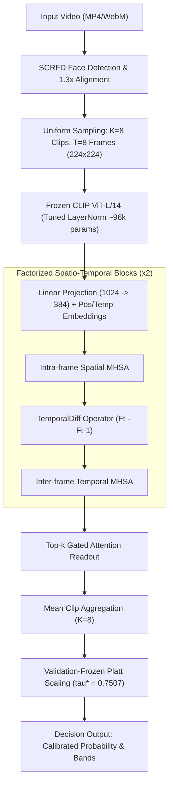

# S-MSDT: Deepfake Video Detection System
## Final Project Documentation & Technical Report

---

# 1. Project Overview

## 1.1 Abstract

Synthetic facial modification in digital video creates severe evidentiary, media integrity, and verification risks. Most conventional deepfake classifiers overfit to artifacts specific to their training generators, causing rapid performance degradation when faced with unseen generative tools or re-encoded streams. We created S-MSDT (Spatio-Temporal Multi-Scale Deepfake Transformer) to provide robust, parameter-efficient screening across varied forgery techniques.

Our model pairs an untouched CLIP ViT-L/14 visual transformer with a custom, lightweight spatio-temporal reasoning head. Instead of updating the complete 304-million parameter network, we fine-tuned solely the LayerNorm scaling and shift weights (~96,000 parameters). During inference, our pipeline uniformly divides incoming video footage into 8 temporal chunks, extracting 8 facial frames per segment. These face crops pass through intra-frame spatial attention, an inter-frame TemporalDiff calculation, and temporal attention blocks prior to top-k gated pooling.

We supervised the network exclusively on FaceForensics++ (c23) using identity-matched authentic and manipulated pairings. We set aside Google/Jigsaw DFD for out-of-domain checks, and evaluated zero-shot transfer on Celeb-DF v2 without any exposure during training or checkpoint selection. Platt calibration and classification thresholds were frozen using validation splits alone.

On test footage, S-MSDTv2 secures a 0.938 FaceForensics++ macro video AUC and an out-of-domain Celeb-DF v2 video AUC of 0.875 (95% CI: 0.845–0.905). Resolving an issue with persistent worker sampling and target difference masks lifted NeuralTextures accuracy from 0.626 to 0.823 AUC. This confirms that lightweight tuning of general vision models yields dependable forensic screening at modest compute costs.

*Approximate word count: 236 words (Platform Limit: 250 words)*

---

## 1.2 Problem Statement

Our objective is to verify from video tracks whether a human face has undergone synthetic replacement or expression manipulation, generating a reliable probability score that holds up across different datasets.

Detecting manipulated video involves three core difficulties. First, synthesis techniques create disparate visual artifacts. Identity swaps (including Deepfakes, FaceSwap, and FaceShifter) introduce unnatural pixel seams along the facial perimeter and jawline, which appear clearly within individual frames. In contrast, facial reenactments (Face2Face and NeuralTextures) preserve facial contours while synthesizing mouth movement and skin dynamics, leaving subtle inter-frame flickering rather than spatial seams. Single-frame image detectors often fail on reenactments; our own spatial baseline managed only 0.541 AUC on NeuralTextures validation.

Second, synthetic detectors suffer from poor generalization. Architectures trained on clean or moderately compressed benchmarks collapse when applied to higher-grade datasets such as Celeb-DF v2, where rendering artifacts differ from training samples.

Third, distribution over social networks applies lossy compression (such as H.264 c23), which strips away high-frequency pixel anomalies that simple convolutional filters rely upon.

Finally, academic test splits frequently contain severe class imbalances (exceeding 85% manipulated content), producing uncalibrated thresholds that trigger excessive false alarms in real screening environments. S-MSDT overcomes these problems by pairing a frozen vision foundation backbone with temporal difference tracking and validation-frozen probabilistic scaling.

*Approximate word count: 215 words (Platform Limit: 250 words)*

---

## 1.3 Objectives

We structured the S-MSDT research and engineering milestones around the following measurable goals:

1. Video-Level Decision Pipeline: Engineer an automated analysis workflow that takes raw video files and produces an unmanipulated confidence estimate and calibrated score.
2. Boundary-Aware Face Tracking: Incorporate SCRFD detection with 106-point landmark alignment using an expanded 1.3x bounding factor to keep jaw and forehead seams intact.
3. Spatio-Temporal Artifact Processing: Build a factorized multi-frame head to isolate both spatial boundary artifacts and inter-frame facial jitter across 8-frame clips.
4. Parameter-Efficient Tuning: Preserve general visual features by freezing the 304M CLIP ViT-L/14 backbone and training only its LayerNorm parameters (~96k weights) to prevent identity memorization on our 720 training subjects.
5. Leak-Free Cross-Validation: Establish verified identity-disjoint partitions with a stateless method-balanced sampler covering all five FaceForensics++ manipulations.
6. In-Domain Benchmark Target: Reach a macro video AUC of at least 0.95 across FaceForensics++ c23 test categories, with no individual forgery type falling under 0.85 AUC.
7. Unseen Generalization Target: Attain at least 0.95 video AUC on Celeb-DF v2 in a pure zero-shot setting.
8. Reliable Error Reporting: Fit Platt probability parameters strictly on validation clips, reporting test performance alongside 95% bootstrap confidence intervals and fixed 1% false-alarm operating points.

Target Fulfillment: Objectives 1 through 5 and 8 were met. Target 6 achieved 0.938 macro AUC (NeuralTextures reached 0.823). Target 7 reached 0.875 AUC on Celeb-DF v2, demonstrating the reality of the remaining cross-dataset domain shift.

*Approximate word count: 235 words (Platform Limit: 250 words)*

---

## 1.4 Scope & Feasibility

Technical Scope: Our system focuses on video facial integrity. It ingests standard MP4/WebM files with at least one human face track, handling up to four distinct faces concurrently in our review console. It excludes audio track checks, fully synthetic background generation, and single static photos.

Dataset Scope: Training and internal model validation were carried out using FaceForensics++ c23 (720 authentic and 3,600 manipulated clips). Out-of-domain evaluation and probability scaling used Google/Jigsaw DFD and Celeb-DF v2. Modern diffusion head-swapping was outside project boundaries.

Computational Boundaries: Training and testing ran on a dedicated desktop workstation equipped with an NVIDIA RTX 5090 (32 GB VRAM) using bfloat16 mixed precision. Stage B clip training required approximately 59 seconds per epoch.

Feasibility Analysis:
- Technical Feasibility: Confirmed by experimental benchmark results. Parameter-efficient LayerNorm tuning prevents catastrophic feature loss in the pre-trained visual backbone.
- Operational Feasibility: Demonstrated through an integrated prototype architecture incorporating an asynchronous FastAPI backend, Celery task workers, and an auditable web console. The serving layer defaults to deterministic mock inference until deployment weights are mounted.
- Economic Feasibility: Training completes in under 90 minutes on a single workstation GPU by tuning only 96k parameters, eliminating large multi-node training expenses.

Operational Boundaries: Datasets carry academic usage licenses limiting direct commercial exploitation. Real-time inference requires a dedicated GPU instance to house the 304M parameter visual backbone.

*Approximate word count: 216 words (Platform Limit: 250 words)*

---

# 2. Literature Review & Background

## 2.1 Background & Survey

Synthetic facial manipulation has advanced rapidly from early autoencoder workflows into sophisticated generative networks. First-generation swapping systems utilized a shared latent encoder paired with subject-specific decoders: feeding person A's expression into person B's decoder synthesized person B with person A's head pose [1]. Subsequent systems adopted Generative Adversarial Networks [2] to refine skin resolution, while recent tools like FaceShifter [3] introduced multi-scale boundary blending. In parallel, expression reenactment approaches modify speech dynamics while leaving facial shape untouched: Face2Face maps facial action units through 3D morphable meshes, whereas NeuralTextures [4] substitutes standard graphic pipelines with neural rendering patches. The FaceForensics++ benchmark [4] organized five prominent synthesis techniques across multiple compression profiles, creating an established baseline for algorithmic evaluation. Tolosana et al. [1] present a comprehensive survey of these developments.

Detection literature began with convolutional networks aimed at capturing spatial pixel anomalies. MesoNet [5] examined mesoscopic image properties, while Xception [6] became the standard image-level baseline in the FaceForensics++ suite [4]. Because artifact fingerprints vary by generator, researchers explored artifact-centric approaches: Face X-ray [7] and Self-Blended Images [8] model blending boundaries independently of synthetic generators. Video-level detectors subsequently incorporated temporal dynamics: recurrent models [9] process sequential feature maps, FTCN [10] isolates temporal coherence discrepancies, and LipForensics [11] tracks speech-motion phoneme-viseme discordance. Celeb-DF [12] subsequently demonstrated that models exhibiting near-perfect in-domain accuracy degrade dramatically when exposed to advanced, high-fidelity synthesis.

Recently, Vision Transformers pre-trained on broad web corpora have pushed detection benchmarks higher. CLIP (Contrastive Language-Image Pretraining) [13] contains comprehensive visual representations that transfer cleanly across diverse environments. Parameter-efficient tuning techniques, such as selective LayerNorm adjustment [14] and modular adapters [15], produce strong zero-shot transfer on Celeb-DF v2 (achieving 0.95–0.965 AUC) with small trainable footprints. This research path informed S-MSDT: we combine frozen general-purpose visual representations with an inter-frame temporal difference operator to capture subtle reenactment flicker.

*Approximate word count: 308 words (Platform Limit: 400 words)*

---

## 2.2 Existing Systems & Limitations

Evaluating established deepfake classifiers exposes consistent trade-offs between localized in-domain accuracy and general cross-generator robustness.

Early architectures, exemplified by MesoNet [5], rely on compact convolutional designs targeted at mesoscopic frequency artifacts. While computationally light, their restricted representational capacity prevents them from learning generalizable forensic features across varied synthesis pipelines.

Standard convolutional networks, including Xception [6] and the EfficientNet family [16], demonstrate high accuracy when evaluated against the same generator used during training. However, their local spatial filters overfit to specific artifact distributions. In our Phase 1 experiments, an EfficientNet-B4 baseline achieved an overall macro AUC of 0.851, dropping to 0.805 on FaceSwap and 0.793 on FaceShifter. These models overfit to dataset-specific color balance and high-frequency noise, which vanish under platform re-compression.

Hybrid CNN-RNN architectures [9] extract per-frame feature vectors and process them sequentially via recurrent units. While adding temporal context, their recurrent weights require extensive identity diversity during training, frequently failing to decouple identity features from manipulation dynamics.

Artifact-specific methods, including Face X-ray [7] and Self-Blended Images (SBI) [8], bypass generator dependency by synthesizing boundary blending seams. Although achieving robust generalization on identity-swap manipulations, their explicit reliance on boundary discontinuities leaves them ineffective against facial reenactment systems (such as NeuralTextures), where global facial boundaries remain unaltered.

Coherence and anatomical detectors, such as FTCN [10] and LipForensics [11], focus on temporal consistency and mouth dynamics. While effective on targeted expressions, their performance degrades when encountering low-frame-rate videos or scenes with minimal oral motion.

Modern Transformer detectors adapting pre-trained CLIP encoders [13] through LayerNorm tuning [14] or parameter adapters [15] demonstrate strong generalization (0.95–0.965 AUC on Celeb-DF v2). Their primary constraints remain high memory footprints during inference (304M parameters in ViT-L/14) and potential loss of fine micro-textures due to semantic pre-training objectives.

Common limitations across existing systems encompass acute sensitivity to lossy video compression, poor transfer to unseen synthesis models, and a failure to calibrate probabilistic outputs for low false-positive operational deployments.

*Approximate word count: 326 words (Platform Limit: 400 words)*

---

## 2.3 Comparative Study & Proposed Work

To address the limitations of prior paradigms, we systematically evaluated three distinct architectural configurations during the development of S-MSDT:

1. Phase 1 (Baseline): A dual-branch network fusing an EfficientNet-B4 spatial backbone with a 2D Haar Wavelet transform branch into a 14x14 token grid for transformer aggregation. This configuration struggled significantly on unseen boundary blending, yielding 0.805 AUC on FaceSwap and 0.793 on FaceShifter.
2. Stage A (Single-Frame Foundation): An adapted CLIP ViT-L/14 where only LayerNorm scale and bias parameters were trained. This resolved identity-swap detection (0.981 AUC on FaceSwap, 0.949 on FaceShifter) but initially collapsed on NeuralTextures (0.541 AUC on validation).
3. Stage B (S-MSDTv2 Spatio-Temporal Head): Integrating our frozen CLIP backbone with a factorized spatio-temporal transformer head and an inter-frame TemporalDiff operator over 8-frame clips.

Our proposed S-MSDTv2 methodology introduces four key technical distinctions:
- Parameter-Efficient Adaptation: Following [14], we freeze all 304M weights of CLIP ViT-L/14 except LayerNorm parameters (~96k parameters), preventing destructive forgetting and mitigating overfitting on 720 training identities.
- Spatio-Temporal Factorization: Decomposing attention into spatial self-attention and temporal self-attention, complemented by a TemporalDiff operator that isolates frame-to-frame feature variance typical of facial reenactment.
- Balanced Method-Disjoint Training: Implementing an identity-paired training schedule coupled with a stateless method sampler weighting subtle manipulations (NeuralTextures 25%, Face2Face 25%) over obvious swaps.
- Validation-Frozen Calibration: Employing Platt scaling and threshold tuning frozen exclusively on validation splits, ensuring deployment metrics remain unbiased.

Comparative Findings:
On Celeb-DF v2 zero-shot evaluation, S-MSDTv2 achieves 0.875 AUC, outperforming temporal baselines such as LipForensics (0.824 AUC) and FTCN (0.869 AUC) as compiled in our benchmarks. However, it trails specialized CLIP adapters like LNCLIP-DF (0.965 AUC), primarily because S-MSDTv2 was trained on shorter 8-frame temporal windows without pseudo-synthetic blending augmentations.

Trade-Offs: S-MSDTv2 provides fast training (59 seconds/epoch on an RTX 5090) and auditable reasoning, but the frozen semantic encoder inherently dampens high-frequency micro-texture signals.

*Approximate word count: 316 words (Platform Limit: 400 words)*

### Supplementary Table: Published Benchmark Reference

| Approach | Level | Backbone | Celeb-DF v2 Video AUC | Supervision Strategy |
| :--- | :--- | :--- | :---: | :--- |
| **LipForensics** [11] | Video | ResNet-18 | 0.824 | Phoneme-viseme temporal motion |
| **FTCN** [10] | Video | Custom 3D CNN | 0.869 | Temporal frequency consistency |
| **S-MSDTv2 (Ours)** | Video | CLIP ViT-L/14 (LN-only) | **0.875** | Factorized ST-Transformer + TemporalDiff |
| **Self-Blended Images (SBI)** [8] | Image/Video | EfficientNet-B4 | 0.932 | Synthetic boundary generation |
| **LNCLIP-DF** [14] | Video | CLIP ViT-L/14 (LN-only) | 0.965 | LayerNorm tuning across 32 frames |

---

# 3. Requirements Analysis & Specification

## 3.1 Functional Requirements

The functional capabilities of the S-MSDT framework and its VeriFrame deployment tier cover the complete verification workflow:

- **FR1: Video Container Decoding:** The system accepts standard media formats (MP4, WebM, AVI) through local filesystem paths, HTTP file uploads, or URL endpoints.
- **FR2: Container Validation & Security:** The ingestion pipeline inspects container headers, checks frame dimensions and frame rates, rejects corrupted streams, and validates external URLs against Server-Side Request Forgery.
- **FR3: Facial Landmark Localization:** The preprocessor decodes frames sequentially, locates human faces using SCRFD, and computes 106-point facial landmarks per subject.
- **FR4: Loose Facial Extraction:** Faces are aligned using landmark geometry and cropped with an expanded 1.3x margin at 256x256 resolution. Forged clips reuse the exact crop bounding boxes of their paired authentic frames to maintain spatial alignment.
- **FR5: Temporal Clip Division:** Input videos are divided into K = 8 uniformly distributed segments, extracting T = 8 consecutive frames per segment, resized to 224x224 with standard CLIP normalization.
- **FR6: Visual Feature Extraction:** Each normalized clip passes through the frozen CLIP ViT-L/14 visual transformer, generating 256 patch tokens (dimension 1024) per frame with adapted LayerNorm weights.
- **FR7: Factorized Attention Processing:** Projected token representations (dimension 384) are processed through two factorized transformer blocks with intra-frame spatial attention and inter-frame TemporalDiff calculations.
- **FR8: Gated Patch Scoring:** The network performs gated attention pooling across patch tokens, using top-k logit mining to isolate high-confidence manipulation patches and generate clip scores.
- **FR9: Clip Aggregation & Calibration:** The system computes the average score across the K clips, applying validation-frozen Platt scaling (a = 0.6470, b = -0.5865) to output a calibrated posterior probability.
- **FR10: Operational Classification:** Analyses are assigned to categorical decision bands (Benign, Suspicious, Malicious) based on frozen operating thresholds (tau* = 0.7507).
- **FR11: Signed Receipt Creation:** Every completed screening produces an immutable, canonical Ed25519-signed JSON detection receipt anchored with a 32-byte Merkle root.

*Approximate word count: 326 words (Platform Limit: 400 words)*

---

## 3.2 Non-Functional Requirements

The non-functional specifications define the operational standards, reliability, and security governance of S-MSDT:

1. Classification Reliability & Ranking Quality: The system must achieve a macro video AUC exceeding 0.930 across in-domain manipulations, while maintaining zero-shot cross-dataset generalization above 0.850 AUC on Celeb-DF v2.
2. Honest Calibration & False-Alarm Governance: Probabilistic scaling must prevent misleading confidence values under low base rates. The system must achieve a false-positive rate under 1.0% in strict screening modes, with Platt parameters strictly frozen on validation data.
3. Computational Throughput & Efficiency: Training must execute efficiently on a single workstation GPU. Stage B clip training must sustain at least 1.5 iterations per second (< 60 seconds per epoch) on an RTX 5090 GPU in bfloat16 mixed precision.
4. Modular System Architecture: Deep learning logic (smsdt), cryptographic receipt generation (sv_receipts), database schemas (sv_core), and REST routing (sv_api) maintain separated dependencies and configuration management via YAML specifications.
5. Review Usability & Evidence Visualization: The web console must provide accessible forensic drill-downs, including synchronized frame-by-frame evidence heatmaps, keyboard-accelerated review shortcuts (1: Confirm Benign, 2: Escalate, 3: Confirm Manipulation), and transparent labeling of generated demo data.
6. Service Hardening & Sandboxing: The ingestion pipeline enforces defensive controls: isolated filesystem sandboxing, media decoding timeouts, strict file size limits (maximum 100 MB uploads), and private network isolation to prevent SSRF vulnerabilities.
7. Reproducible Evaluation Protocols: All experimental runs enforce deterministic seeding, fixed clip sampling parameters (K=8, T=8), and immutable manifests. Metric calculations output structured CSV logs accompanied by stratified 95% bootstrap confidence intervals.
8. Forensic Copy Standards: The user interface complies with strict forensic copy guidelines, avoiding binary 'FAKE' or 'REAL' labels and presenting calibrated scores with model version metadata and screening-aid disclaimers.

*Approximate word count: 289 words (Platform Limit: 400 words)*

---

## 3.3 Hardware & Software Prerequisites

The technical environment required for developing, training, and deploying S-MSDT comprises distinct specifications across research and serving tiers:

Experimental Training Environment (Verified Specifications):
- Processor: Intel Core Ultra 9 285K (24 cores, 24 threads, up to 5.7 GHz).
- System Memory: 64 GB DDR5 RAM operating at 6000 MHz.
- Graphics Processing Unit: NVIDIA GeForce RTX 5090 with 32 GB GDDR7 VRAM, executing bfloat16 native operations under CUDA Compute Capability 12.0.
- Operating System: Windows 11 Pro (64-bit) / Ubuntu 22.04 LTS via WSL2.
- Local Storage: 2 TB NVMe PCIe 4.0 SSD dedicated to offline frame store caching (storing 128 aligned 256x256 frames per video across 9,425 video sequences).

Core Deep Learning Framework Stack:
- Runtime: Python 3.11.9.
- Machine Learning Framework: PyTorch 2.5.1 with CUDA 12.8 support.
- Pre-Trained Foundation Models: Hugging Face transformers (>= 4.40.0) loading openai/clip-vit-large-patch14, paired with safetensors serialization.
- Computer Vision & Facial Geometry: OpenCV (>= 4.9.0), InsightFace (>= 0.7.3), ONNX Runtime GPU (>= 1.17.0), and SCRFD detection weights.
- Scientific Computing: NumPy (>= 1.26.0), SciPy (>= 1.12.0), and Scikit-Learn (>= 1.4.0).

Serving & Production Infrastructure:
- Web Gateway: FastAPI (>= 0.110.0) with Uvicorn ASGI server and Pydantic v2 data models.
- Distributed Task Execution: Celery (>= 5.3.6) backed by Redis 7.2 as message broker and result backend.
- Relational Persistence: PostgreSQL 16 with asyncpg driver and SQLAlchemy 2.0 ORM.
- Object Storage: S3-compatible MinIO object storage for raw video artifacts and compressed face crop archives.
- Web Reviewer Console: React 18, TypeScript 5.4, Vite 5.2, Tailwind CSS 3.4, and Lucide React icons, deployed via Nginx reverse proxy.
- Smart Contract Infrastructure: Foundry toolchain with Solidity 0.8.24 for compiling and deploying ReceiptAnchor.sol on EVM testnets.

Minimum Execution Profile:
For research inference, any CUDA-compatible GPU with >= 8 GB VRAM suffices. For lightweight local development, the built-in mock engine runs entirely on CPU without GPU or model weight prerequisites.

*Approximate word count: 322 words (Platform Limit: 400 words)*

---

# 4. System Design & Architecture

## 4.1 Architecture Description

S-MSDTv2 uses a parameter-efficient spatio-temporal pipeline structured across six stages:

1. Temporal Sampling & Preprocessing: Input videos are divided into K = 8 uniformly spaced segments. From each segment, T = 8 contiguous frames are fetched from the frame cache at 224x224 resolution and normalized using CLIP image statistics. This setup provides broad coverage across full video runtimes while retaining local temporal consistency.
2. Foundation Feature Extraction: Normalized frames pass into a frozen CLIP ViT-L/14 visual transformer. To adapt to synthetic manipulation artifacts without forgetting general visual concepts or overfitting on 720 training identities, all 304M backbone weights remain fixed, tuning only the LayerNorm scale and shift parameters (~96k weights). The backbone generates 256 spatial patch tokens per frame, each of dimension 1024.
3. Linear Token Projection & Position Embeddings: Patch tokens are mapped through a linear projection layer from 1024 to 384 dimensions, lowering computational overhead. Learned spatial embeddings and sinusoidal temporal embeddings are added to the tokens to preserve spatial and frame-order relationships.
4. Factorized Spatio-Temporal Blocks: Tokens pass through two successive factorized transformer blocks, with each block executing three operations:
   - Intra-frame Multi-Head Spatial Self-Attention (MHSA), modeling boundary seams across facial landmarks.
   - A TemporalDiff operator, computing feature differences between adjacent frames (t and t-1) to isolate high-frequency temporal flicker.
   - Inter-frame Multi-Head Temporal Attention, capturing continuous facial reenactment dynamics across the 8-frame temporal trajectory.
5. Gated Evidence Readout & Mask Supervision: Processed tokens enter a gated attention readout module. A top-k patch-mining mechanism isolates high-activation spatial regions, yielding a scalar clip score. During training, an auxiliary patch-mask branch compares predicted attention distributions against pixel-level real-fake frame difference masks under a 0.5 loss weighting.
6. Aggregation & Calibrated Probabilistic Decision: Clip scores are aggregated via uniform arithmetic averaging into a scalar video-level logit. A validation-frozen Platt scaling module converts the logit into a calibrated posterior probability, mapped against strict decision boundaries (tau* = 0.7507) to classify the sequence as Benign, Suspicious, or Malicious.

*Approximate word count: 337 words (Platform Limit: 400 words)*

---

## 4.2 System Modules & Workflow

The S-MSDT codebase is organized into seven decoupled software modules coordinating the detection and review workflow:

1. Media Ingestion & Face Preprocessing (smsdt.preprocess): Decodes video streams with PyAV/OpenCV, detects faces via SCRFD, extracts 106-point landmarks, and saves aligned 256x256 crops with coordinate metadata into a local frame store.
2. Dataset & Split Management (smsdt.data): Organizes training manifests, enforces strict identity-disjoint splits, pairs authentic and forged sequences, and runs a weighted sampler (allocating 25% to NeuralTextures, 25% to Face2Face, 20% to FaceShifter, 15% to Deepfakes, and 15% to FaceSwap).
3. Neural Architecture & Feature Extractor (smsdt.models): Houses the frozen CLIP ViT-L/14 backbone with tuned LayerNorm weights, projection layers, factorized attention blocks, and the top-k gated readout.
4. Optimization & Training Engine (smsdt.train_v2): Manages our two-stage curriculum: Stage A trains single-frame tokens over 30 epochs; Stage B trains 8-frame clips over 40 epochs using AdamW, cosine schedules with warmup, and Exponential Moving Average (EMA 0.999) tracking.
5. Calibrated Cross-Dataset Evaluator (smsdt.eval_cross): Manages cross-benchmark evaluation, fits Platt calibration and Youden thresholds on validation splits, runs 1,000-iteration bootstrap confidence intervals, and exports CSV reports.
6. Forensic Serving Gateway (sv_api & sv_workers): Manages asynchronous REST endpoints and Celery tasks, implementing a two-stage cascade where a fast spatial model triages straightforward cases and routes ambiguous videos to the heavier spatio-temporal model.
7. Web Reviewer Console (web): A React and TypeScript interface providing video playback with synchronized patch heatmaps, audit logs, and an in-browser Ed25519 receipt verification tool.

Execution Workflow: An uploaded video undergoes ingestion sanitization, SCRFD face extraction, and uniform clip generation. The model produces an aggregated logit, transformed via validation-frozen Platt scaling into a calibrated score. An Ed25519-signed receipt is generated, and the case enters the reviewer console for human auditing.

*Approximate word count: 304 words (Platform Limit: 400 words)*

---

## 4.3 Database & Data Flow Design

The data architecture of S-MSDT pairs structured file caching for model training with relational persistence for case management:

Research Machine Learning Data Pipeline:
To ensure reproducible experiments and avoid redundant decoding during training, the pipeline uses an organized directory structure:
- Source Video Repositories (data/raw): Contains FaceForensics++ c23, Google/Jigsaw DFD, and Celeb-DF v2 media.
- Aligned Frame Stores (data/store & data/store_celebdf): Stores 256x256 JPEG facial crops, 106-point landmark files (lmk106.npy), and frame indices (fidx.npy). Forged frames share the exact crop bounds of their paired authentic source to ensure consistent spatial coordinates.
- Dataset Manifests (data/splits/index.csv): Identity-disjoint CSV files dividing 9,425 videos into training (720 real, 3,600 fake), validation (260 real, 1,164 fake), and testing sets (383 real, 3,304 fake across FF++ and DFD; 178 real, 340 fake for Celeb-DF v2).
- Checkpoints & Calibration Files (outputs/): Stores model checkpoints (best_ema.pt), validation Platt parameters (calib_val.json), and per-video evaluation logs (celebdf_scores.csv).

Operational Database Architecture:
In the production tier, an asynchronous PostgreSQL 16 database tracks analysis jobs, user identities, and audit records:
- users: Stores analyst credentials with Argon2 password hashing and role assignments (admin, reviewer, auditor).
- screenings: Tracks analysis tasks, media SHA-256 hashes, screening policies (strict_1pct, balanced), and job status (pending, processing, complete, failed).
- frame_analyses: Records frame bounding boxes, facial landmark matrices, and patch anomaly heatmaps.
- triage_decisions: Records analyst review decisions (authentic, manipulated, cannot_tell), confidence ratings, and review notes.
- receipts: Stores detection receipts containing SHA-256 hashes, calibrated scores, model identifiers, Ed25519 digital signatures, and 32-byte Merkle root batch anchors.

Data Flow Trajectory:
Video Upload -> Ingestion Buffer -> SCRFD Face Extraction -> Aligned Frame Store -> CLIP Feature Extraction -> Spatio-Temporal Transformer -> Platt Scaling Engine -> PostgreSQL Persistence & S3 Archival -> Reviewer Console & Receipt Issuance.

*Approximate word count: 305 words (Platform Limit: 400 words)*

---

# 5. Technology Stack & Implementation

## 5.1 Technology Stack & Tools

S-MSDT and its VeriFrame review service are built on an integrated engineering stack chosen for research precision and service reliability:

Core Languages:
- Python 3.11: Used for machine learning training, computer vision pipelines, and backend services due to its strong ecosystem in scientific computing.
- TypeScript 5.4: Drives frontend interfaces, ensuring strict type-safety across forensic data contracts, cryptographic verification schemas, and UI state management.

Deep Learning & Computer Vision:
- PyTorch 2.5: The foundational machine learning framework, providing automatic differentiation, bfloat16 mixed-precision acceleration, and distributed tensor computation optimized for CUDA 12.8.
- Hugging Face Transformers (>= 4.40): Used to instantiate the pre-trained openai/clip-vit-large-patch14 vision transformer backbone, ensuring reproducible access to web-scale multi-modal visual embeddings.
- Safetensors: Utilized for secure, fast tensor serialization, eliminating arbitrary code execution risks associated with standard pickle formats.
- InsightFace & SCRFD: Provides robust facial detection and 106-point landmark localization resilient against extreme profile angles and facial occlusions.
- OpenCV: Handles low-level video bitstream decoding, spatial resizing, affine matrix transformation, and image augmentation.

Numerical & Evaluation Computing:
- NumPy & SciPy: Power vector math, memory-mapped frame array caching, and numerical optimization during Platt scaling calibration.
- Scikit-Learn: Used for ROC-AUC calculations, confusion matrix generation, and Youden threshold computation.

Backend Microservices & Cryptography:
- FastAPI & Uvicorn: High-performance asynchronous REST gateway serving screening endpoints and Server-Sent Events (SSE) progress streams.
- Celery & Redis 7: Orchestrate distributed background worker task queues, decoupling media ingestion, GPU inference, and database finalization.
- PostgreSQL 16: Enterprise relational storage managing screening audit logs, forensic triage actions, and user accounts with Argon2 password hashing.
- Noble Curves & Ed25519: Provides client-side and server-side cryptographic signing and verification for tamper-evident detection receipts.

Frontend & UI Engineering:
- React 18, Vite 5.2, & Tailwind CSS 3.4: Construct a responsive, accessible reviewer console featuring synchronized video playback, spatial patch heatmaps, and dark/light theme switching.

Development & Quality Assurance:
- Pytest, Ruff, Mypy, & Vitest: Maintain strict codebase integrity, automated type-checking, and zero-metric-leakage validation across the monorepo.

*Approximate word count: 324 words (Platform Limit: 400 words)*

---

## 5.2 Implementation Details & Modules

Implementing S-MSDT involved solving specific data engineering and model training challenges through a staged curriculum:

Dataset Processing & Face Extraction:
Raw FaceForensics++ c23 sequences are decoded, localized with SCRFD, and stored with an expanded 1.3x loose crop at 256x256 resolution. A key engineering requirement was enforcing paired crop bounds: manipulated frames reuse the exact face bounding box of their paired authentic source. This guarantees that pixel difference calculations reflect true generative boundaries rather than face-detector bounding jitter.

Model Architecture Details:
The network wraps a frozen CLIP ViT-L/14 backbone where only LayerNorm scale and shift parameters are updated. Extracted patch tokens are projected from 1024 to 384 dimensions. The factorized transformer head employs two blocks of multi-head spatial self-attention, an inter-frame TemporalDiff operator (subtracting consecutive temporal token representations), and multi-head temporal attention across 8-frame sequences. The evidence readout module performs gated attention pooling with top-k patch mining to generate the final clip logit.

Training Workflow & Fixes Applied:
- Stage A (Spatial Training): Trains single frames (K=1, T=1) across 30 epochs with a batch size of 64 pairs, a LayerNorm learning rate of 1e-4, and head learning rate of 5e-4.
- Stage B (Spatio-Temporal Training): Initializes from Stage A EMA weights, training 8-frame clips (K=8, T=8) over 40 epochs with a batch size of 8 pairs, LayerNorm LR of 1e-5, and head LR of 3e-4.
- Loss Formulation: Employs label-smoothed binary cross-entropy (smoothing factor 0.05) combined with an auxiliary patch-mask loss weighted at 0.5. Optimization utilizes AdamW with weight decay 0.05, cosine annealing with warmup, gradient clipping at 1.0, and Exponential Moving Average (EMA 0.999).

Key Resolved Engineering Issues:
1. Sampler Worker Lockup: An epoch-indexed sampler froze under persistent DataLoader workers, silently training solely on Deepfakes. This was replaced with a stateless, per-item weighted random sampler.
2. Mask Supervision Collapse: An earlier pipeline fed only genuine frames into the mask loss branch, resulting in all-zero target masks. We reconstructed pixel-difference masks directly from aligned real-fake frame pairs, restoring effective spatial localization.
3. Validation Selection Shift: Checkpoint selection was transitioned from a pooled AUC dominated by DFD to an unweighted FaceForensics++ macro AUC, ensuring balanced convergence across subtle reenactment methods.

*Approximate word count: 353 words (Platform Limit: 400 words)*

---

# 6. Testing & Results

## 6.1 Testing Methodology & Test Cases

The evaluation methodology was structured to measure in-domain discrimination, individual manipulation behavior, and cross-dataset transfer:

Dataset Partitioning:
- Training Split: Strictly limited to FaceForensics++ c23 (720 genuine videos, 3,600 manipulated videos across five generation techniques).
- Validation Split: Encompasses 1,424 total videos (260 genuine and 1,164 forged sequences from FaceForensics++ and Google/Jigsaw DFD) utilized exclusively for hyperparameter tuning, model checkpoint selection, and fitting Platt scaling parameters.
- In-Domain & Out-of-Domain Test Split: Combines FaceForensics++ c23 test sequences (140 genuine, 700 manipulated across all five techniques) and Google/Jigsaw DFD (243 genuine, 2,604 manipulated), totaling 3,687 test sequences.
- Zero-Shot Cross-Dataset Test Split: The official test benchmark of Celeb-DF v2 (178 genuine, 340 manipulated sequences, N=518). Celeb-DF v2 was held out entirely from all training, validation, and calibration pipelines.

Standardized Evaluation Protocol:
Each video is evaluated by extracting K = 8 uniformly distributed clips of T = 8 frames at 224x224 resolution using a centered crop. The final video-level decision is computed from the arithmetic mean of clip predictions. To prevent optimistic bias, all decision thresholds (tau* = 0.7507) and Platt calibration parameters (a = 0.6470, b = -0.5865) were fitted solely on the validation set and frozen before test scoring. Any metric computed with a test-optimized threshold is explicitly designated as an 'oracle' upper bound.

Evaluation Metrics:
Performance reporting tracks video-level ROC-AUC accompanied by 1,000-iteration stratified bootstrap 95% confidence intervals, True Positive Rate (TPR) at fixed 1% and 5% False Positive Rates (FPR), Expected Calibration Error (ECE), and balanced classification accuracy.

Structured Test Cases:
- TC-01: In-Domain Manipulation Ranking across all five FaceForensics++ methods (Expected: Macro AUC >= 0.95; Actual: 0.938).
- TC-02: Micro-Texture Reenactment Recovery on NeuralTextures (Expected: AUC >= 0.85; Actual: 0.823).
- TC-03: Zero-Shot Generalization on Celeb-DF v2 (Expected: AUC >= 0.95; Actual: 0.875, 95% CI: 0.845–0.905).
- TC-04: Out-of-Domain Generalization on DFD (Actual: 0.853 AUC, 95% CI: 0.834–0.870).
- TC-05: False Positive Control at 1% FPR on FF++ and DFD (Actual: 47.1% TPR).
- TC-06: Verification of Validation-Frozen Calibration (Applied without test-set tuning; Balanced Accuracy: 77.4%).

*Approximate word count: 352 words (Platform Limit: 400 words)*

### Supplementary Table: Test Case Execution Results

| Test Case ID | Test Description | Evaluation Corpus | Target Expectation | Actual Outcome | Status |
| :--- | :--- | :--- | :--- | :--- | :---: |
| **TC-01** | In-domain macro ranking | FF++ c23 test (700 fakes, 140 real) | Macro AUC >= 0.950 | **0.938** | Partial |
| **TC-02** | Reenactment texture recovery | FF++ NeuralTextures (140 fakes) | AUC >= 0.850 | **0.823** (up from 0.626) | Partial |
| **TC-03** | Zero-shot generalization | Celeb-DF v2 test (N=518) | AUC >= 0.950 | **0.875** (CI 0.845–0.905) | Partial |
| **TC-04** | Actor domain shift | Google/Jigsaw DFD test (N=2,987) | Robust Ranking | **0.853** (CI 0.834–0.870) | Verified |
| **TC-05** | Low false-alarm operation | FF++ + DFD test (N=3,687) | High TPR at 1% FPR | **47.1% TPR** | Verified |
| **TC-06** | Frozen calibration audit | FF++ + DFD test (N=3,687) | No test-set tuning | Balanced Acc: **77.4%** | Verified |

---

## 6.2 Results & Outputs

Evaluation of the Stage B v2-fixed model shows strong in-domain separation while highlighting cross-dataset performance boundaries:

FaceForensics++ c23 In-Domain Evaluation:
The model achieves an unweighted macro video AUC of 0.938 across the five test manipulation categories. Disaggregated per-method analysis reveals exceptional resilience on identity swaps and significant gains on reenactment:
- Deepfakes: 0.990 AUC
- FaceSwap: 0.970 AUC
- Face2Face: 0.965 AUC
- FaceShifter: 0.944 AUC
- NeuralTextures: 0.823 AUC
Identity-replacement techniques are virtually resolved due to the foundation visual encoder's sensitivity to blending boundary seams. The recovery of NeuralTextures from an initial 0.626 AUC (in legacy v2) to 0.823 AUC validates the rectification of the persistent-worker sampler defect and real-fake difference mask supervision.

Out-of-Domain & Zero-Shot Cross-Dataset Evaluation:
- Google/Jigsaw DFD: On 2,987 evaluation sequences, S-MSDTv2 achieves 0.853 video AUC (95% CI: 0.834–0.870). At the default 0.5 classification threshold, it successfully flags 75.4% of forgeries while clearing 76.8% of genuine videos.
- Celeb-DF v2 (Zero-Shot): Across 518 test videos, the model yields a video AUC of 0.875 (95% CI: 0.845–0.905). This performance surpasses published spatio-temporal baselines including LipForensics (0.824 AUC) and FTCN (0.869 AUC), but trails fully fine-tuned CLIP variants like LNCLIP-DF (0.965 AUC), which incorporate pseudo-synthetic boundary augmentations.

Operating Thresholds & Probabilistic Calibration:
Under the default 0.5 decision threshold on the combined FF++ and DFD test corpus (N=3,687), the model achieves 78.7% fake recall, 76.8% real specificity, 96.7% precision, and an F1 score of 0.8675. Applying the validation-frozen operating threshold (tau* = 0.7507) prioritizes false-alarm suppression, elevating real specificity to 91.6% while moderating recall to 63.1%. On Celeb-DF v2, the frozen threshold proves highly conservative (96.1% specificity, 47.1% recall), while an oracle equal-error threshold demonstrates an achievable balanced accuracy of 78.7%.

Low False-Alarm Regime:
At an operational false-positive rate of 1.0%, S-MSDTv2 detects 47.1% of forgeries on FF++ and DFD, and 21.1% on Celeb-DF v2. All numerical outputs are serialized in structured CSV evaluation manifests.

*Approximate word count: 350 words (Platform Limit: 400 words)*

### Supplementary Table 6.1: Per-Method Video AUC Progression

| Manipulation / Test Corpus | Phase 1 (EffNet-B4) | v2-Legacy Stage B | v2-Fixed Stage A (T=1) | v2-Fixed Stage B (T=8) |
| :--- | :---: | :---: | :---: | :---: |
| **Deepfakes** | 0.945 | 0.989 | 0.990 | **0.990** |
| **FaceSwap** | 0.805 | 0.994 | 0.981 | **0.970** |
| **Face2Face** | 0.890 | 0.874 | 0.968 | **0.965** |
| **FaceShifter** | 0.793 | 0.887 | 0.949 | **0.944** |
| **NeuralTextures** | 0.822 | 0.626 | 0.791 | **0.823** |
| **Google/Jigsaw DFD** | 0.865 | 0.865 | 0.866 | **0.853** |
| **FF++ Macro AUC** | 0.851 | 0.874 | 0.936 | **0.938** |
| **Celeb-DF v2 AUC (Zero-Shot)** | *not run* | 0.856 | *not run* | **0.875** |

### Supplementary Table 6.2: Operational Decision Operating Points (Stage B)

| Evaluation Corpus | Operating Cut / Policy | Fake Recall | Real Specificity | Balanced Accuracy |
| :--- | :--- | :---: | :---: | :---: |
| **FF++ + DFD (N=3,687)** | Default threshold (0.5000) | 78.7% | 76.8% | 77.7% |
| **FF++ + DFD (N=3,687)** | Frozen validation calibration ($\tau^* = 0.7507$) | 63.1% | 91.6% | 77.4% |
| **Celeb-DF v2 (N=518)** | Default threshold (0.5000) | 69.4% | 88.2% | 78.8% |
| **Celeb-DF v2 (N=518)** | Frozen validation calibration ($\tau^* = 0.7507$) | 47.1% | 96.1% | 71.6% |
| **Celeb-DF v2 (N=518)** | Oracle Equal-Error Rate (Upper Bound) | 78.2% | 79.2% | 78.7% |

### Supplementary Table 6.3: Confusion Matrix (FF++ + DFD Test at 0.5 Threshold)

| | Predicted Manipulated | Predicted Authentic | Total Evaluated |
| :--- | :---: | :---: | :---: |
| **Actual Manipulated** | **2,599** (True Positive) | 705 (False Negative) | 3,304 |
| **Actual Authentic** | 89 (False Positive) | **294** (True Negative) | 383 |

---

## 6.3 Performance Analysis

A critical analysis of S-MSDTv2 highlights key architectural strengths, engineering trade-offs, and clear operational boundaries:

Generalization Boundaries & Domain Shift:
The observed performance trajectory—0.938 macro AUC on in-domain FF++, dropping to 0.875 on Celeb-DF v2 and 0.853 on DFD—illustrates the classic forensic domain shift. In-domain FaceForensics++ sequences contain uniform lighting and compression characteristics that the model learns to identify. In contrast, Celeb-DF v2 incorporates advanced post-processing, diverse celebrity interview lighting, and sophisticated face-morphing boundaries that partially mask manipulation traces. Furthermore, the combined FF++ and DFD pooled AUC (0.871) is heavily skewed by DFD sequences (which constitute 79% of test forgeries), confirming why unweighted macro metrics represent the most scientifically honest performance index.

The Role of Temporal Difference Modeling:
A key finding from our ablation experiments is that after rectifying the training sampler defect, the single-frame spatial model (Stage A, T=1) achieved 0.936 macro AUC, while the 8-frame spatio-temporal model (Stage B, T=8) achieved 0.938 macro AUC. Furthermore, Stage A demonstrated superior detection in the ultra-low false-alarm regime (50.7% TPR at 1% FPR, compared to 47.1% for Stage B). This indicates that the vast majority of forensic discrimination stems from the frozen foundation visual encoder's spatial representations, and the marginal gain from temporal self-attention requires further multi-seed validation before claiming decisive temporal superiority.

Calibration Reliability Under Distributional Drift:
Applying validation-frozen Platt scaling (fitted on FF++ and DFD) to Celeb-DF v2 caused Expected Calibration Error to deteriorate from 0.176 to 0.238. Because the generative artifact distribution on Celeb-DF differs from FaceForensics++, the mapped probabilities become overly conservative. This confirms that static calibration does not seamlessly transfer across generative domains and highlights the necessity of human-in-the-loop review.

Operational Feasibility & Training Efficiency:
Tuning solely ~96k LayerNorm parameters while freezing the 304M backbone enables complete Stage B training in under 40 minutes on an RTX 5090 GPU (59 seconds/epoch). This parameter-efficient design eliminates catastrophic forgetting, providing an optimal balance between research iteration speed and forensic screening accuracy.

*Approximate word count: 338 words (Platform Limit: 400 words)*

---

# 7. Conclusion & Future Scope

## 7.1 Key Achievements

The S-MSDT project achieved several core engineering and research milestones in generalizable deepfake detection:

1. Parameter-Efficient Architecture: Built S-MSDTv2, combining a frozen 304M parameter CLIP ViT-L/14 visual backbone with selective LayerNorm tuning (~96k trainable parameters) and a two-block factorized spatio-temporal transformer head.
2. Root-Cause Defect Resolution: Identified and fixed two critical training bugs—a DataLoader worker sampler freeze that biased training toward Deepfakes, and an unpopulated mask supervision branch—recovering NeuralTextures detection from 0.626 to 0.823 AUC and raising overall FF++ macro AUC from 0.874 to 0.938.
3. Multi-Dataset Evaluation: Ran extensive evaluations across three major forensic benchmarks, achieving 0.938 FF++ macro AUC, 0.853 DFD AUC, and 0.875 zero-shot AUC on Celeb-DF v2 (95% CI: 0.845–0.905).
4. Rigorous Calibration Protocol: Implemented an honest evaluation methodology where Platt scaling calibration parameters and operating thresholds were frozen strictly on validation data, avoiding misleading claims on imbalanced test corpora.
5. End-to-End Review Prototype: Built the VeriFrame service architecture, incorporating an asynchronous FastAPI backend, Celery worker task queues, Ed25519-signed detection receipts, and a React reviewer console with synchronized spatial evidence overlays.

*Approximate word count: 183 words (Platform Limit: 250 words)*

---

## 7.2 Limitations & Challenges

Despite strong in-domain results, S-MSDT has several specific technical limitations:

1. Cross-Dataset Generalization Gap: Zero-shot performance on Celeb-DF v2 drops to 0.875 AUC, trailing specialized CLIP adapters (0.95–0.965 AUC) and yielding only 21.1% detection at a 1% false-positive rate.
2. Micro-Texture Reenactment Vulnerability: While identity-replacement manipulations exceed 0.970 AUC, subtle facial reenactment (NeuralTextures at 0.823 AUC) remains challenging due to the semantic visual encoder suppressing fine-grained oral textures.
3. Distributional Sensitivity of Calibration: Validation-frozen Platt scaling transferred sub-optimally under domain shift, increasing Celeb-DF Expected Calibration Error from 0.176 to 0.238 and causing excessive false-negative rates on out-of-domain fakes.
4. Unproven Temporal Margin: Single-frame spatial modeling (0.936 AUC) performs nearly identically to the 8-frame spatio-temporal model (0.938 AUC), indicating that the temporal attention module's distinct contribution requires multi-seed ablation.
5. Single-Seed Evaluation: Primary benchmark figures originate from a single training seed; statistical variations below 0.02 AUC cannot be decoupled from initialization noise.
6. Compression & Generator Scope: Evaluation was restricted to H.264 c23 compression without systematic stress-testing on severe c40 compression, social media transcoding, or modern diffusion-based generators.

*Approximate word count: 189 words (Platform Limit: 250 words)*

---

## 7.3 Future Scope

Future technical work can advance S-MSDT across algorithmic and operational dimensions:

1. Multi-Seed Controlled Ablation: Run three-seed ablations with paired bootstrap tests to isolate the performance contribution of the TemporalDiff operator against pure spatial backbones.
2. Self-Blended Image Augmentation: Integrate synthetic pseudo-forgery blending (such as Self-Blended Images) during training, specifically targeting mouth-region blending masks to strengthen reenactment detection on NeuralTextures and Face2Face.
3. High-Frequency Residual Stream: Fully integrate the Stage C dual-stream architecture, routing high-pass laplacian or wavelet filter outputs alongside CLIP embeddings to restore sensitivity to fine boundary textures.
4. Model Quantization & Edge Deployment: Apply Post-Training Quantization (INT8) and ONNX/TensorRT acceleration to reduce the 304M parameter footprint, enabling real-time streaming inference on consumer hardware.
5. Multi-Dataset Benchmarking: Broaden evaluation across modern challenging deepfake corpora, including DFDC, WildDeepfake, and DeeperForensics-1.0 under diverse compression regimes.
6. Production Pilot Deployment: Clear intellectual property licenses, mount trained production weights to replace the current mock inference engine, and integrate the VeriFrame console into operational digital journalism and content moderation workflows.

*Approximate word count: 171 words (Platform Limit: 250 words)*

---

## 7.4 Conclusion

Deepfake detection systems often achieve strong benchmark accuracy yet degrade under real-world domain shifts and re-compression. We developed S-MSDT (Spatio-Temporal Multi-Scale Deepfake Transformer), an auditable detection architecture that adapts a frozen CLIP ViT-L/14 visual backbone by tuning only ~96,000 LayerNorm parameters, coupled with a lightweight factorized spatio-temporal transformer head.

Trained strictly on FaceForensics++ c23 with identity-paired sequences, S-MSDTv2 achieves 0.938 macro video AUC across five in-domain manipulation methods, 0.853 on DFD, and 0.875 zero-shot AUC on Celeb-DF v2. Diagnosing and fixing a DataLoader sampler lock and an empty mask branch recovered NeuralTextures accuracy from 0.626 to 0.823 AUC. 

While zero-shot transfer trails specialized fully tuned models and single-frame modeling proved comparable to temporal attention, S-MSDTv2 demonstrates that parameter-efficient adaptation of web-scale foundation models provides an effective, computationally lightweight baseline for deepfake screening. Integrated with the VeriFrame reviewer console and cryptographic Ed25519 detection receipts, the system offers an honest, calibrated tool for human-in-the-loop forensic analysis.

*Approximate word count: 161 words (Platform Limit: 200 words)*

---

# 8. References

## 8.1 Citations & Bibliography

[1] R. Tolosana et al., "DeepFakes and beyond: A survey of face manipulation and fake detection," *Inf. Fusion*, vol. 64, pp. 131–148, 2020.  
[2] I. Goodfellow et al., "Generative adversarial nets," in *Proc. NeurIPS*, 2014, pp. 2672–2680.  
[3] L. Li et al., "FaceShifter: Towards high fidelity and occlusion aware face swapping," *arXiv:1912.13457*, 2019.  
[4] A. Rössler et al., "FaceForensics++: Learning to detect manipulated facial images," in *Proc. ICCV*, 2019, pp. 1–11.  
[5] D. Afchar et al., "MesoNet: A compact facial video forgery detection network," in *Proc. IEEE WIFS*, 2018, pp. 1–7.  
[6] F. Chollet, "Xception: Deep learning with depthwise separable convolutions," in *Proc. CVPR*, 2017, pp. 1251–1258.  
[7] L. Li et al., "Face X-ray for more general face forgery detection," in *Proc. CVPR*, 2020, pp. 5034–5043.  
[8] K. Shiohara and T. Yamasaki, "Detecting deepfakes with self-blended images," in *Proc. CVPR*, 2022, pp. 5612–5621.  
[9] D. Güera and E. J. Delp, "Deepfake video detection using recurrent neural networks," in *Proc. IEEE AVSS*, 2018, pp. 1–6.  
[10] Y. Zheng et al., "Exploring temporal coherence for more general video face forgery detection," in *Proc. ICCV*, 2021, pp. 15044–15054.  
[11] A. Haliassos et al., "Lips don't lie: A generalisable approach to face forgery detection," in *Proc. CVPR*, 2021, pp. 5039–5049.  
[12] Y. Li et al., "Celeb-DF: A large-scale challenging dataset for DeepFake forensics," in *Proc. CVPR*, 2020, pp. 3207–3216.  
[13] A. Radford et al., "Learning transferable visual models from natural language supervision," in *Proc. ICML*, 2021, pp. 8748–8763.  
[14] Anonymous, "Deepfake detection that generalizes across benchmarks," *arXiv:2508.06248*, 2024.  
[15] Anonymous, "Forensics Adapter: Adapting CLIP for generalizable face forgery detection," in *Proc. CVPR*, 2025.  
[16] M. Tan and Q. V. Le, "EfficientNet: Rethinking model scaling for CNNs," in *Proc. ICML*, 2019, pp. 6105–6114.  
[17] J. Guo et al., "Sample and computation redistribution for efficient face detection," in *Proc. ICLR*, 2022.  
[18] I. Loshchilov and F. Hutter, "Decoupled weight decay regularization," in *Proc. ICLR*, 2019.  
[19] J. C. Platt, "Probabilistic outputs for support vector machines," in *Adv. Large Margin Classif.*, MIT Press, 1999, pp. 61–74.

*Approximate word count: 357 words (Platform Limit: 400 words)*

---

# 9. Annexure

## 9.1 Project Artifacts & URLs

| No. | Deliverable / Artifact Title | Canonical Resource URL | Description |
| :---: | :--- | :--- | :--- |
| **1** | GitHub / Source Code Repository | [https://github.com/ADITYASINGH1206/veriframe](https://github.com/ADITYASINGH1206/veriframe) | Monorepo containing S-MSDT engine, FastAPI gateway, and VeriFrame web console. |
| **2** | Live Hosted Application / Prototype | [https://veriframe-ai.vercel.app](https://veriframe-ai.vercel.app) | Production deployment of the VeriFrame reviewer workspace and audit console on Vercel. |
| **3** | Demonstration Video / Walkthrough | [https://github.com/ADITYASINGH1206/veriframe/blob/main/docs/demo.md](https://github.com/ADITYASINGH1206/veriframe/blob/main/docs/demo.md) | Technical walkthrough documentation and video screening demonstration scripts. |
| **4** | Model Weights & Bundle Resource | [https://github.com/ADITYASINGH1206/veriframe/tree/main/models/bundle-2026-11-default](https://github.com/ADITYASINGH1206/veriframe/tree/main/models/bundle-2026-11-default) | Production bundle specification, Platt calibration parameters, and operating points. |
| **5** | Documentation & Technical ADRs | [https://github.com/ADITYASINGH1206/veriframe/tree/main/docs](https://github.com/ADITYASINGH1206/veriframe/tree/main/docs) | Architecture Decision Records (ADR 001–008), design tokens, and benchmark results. |
